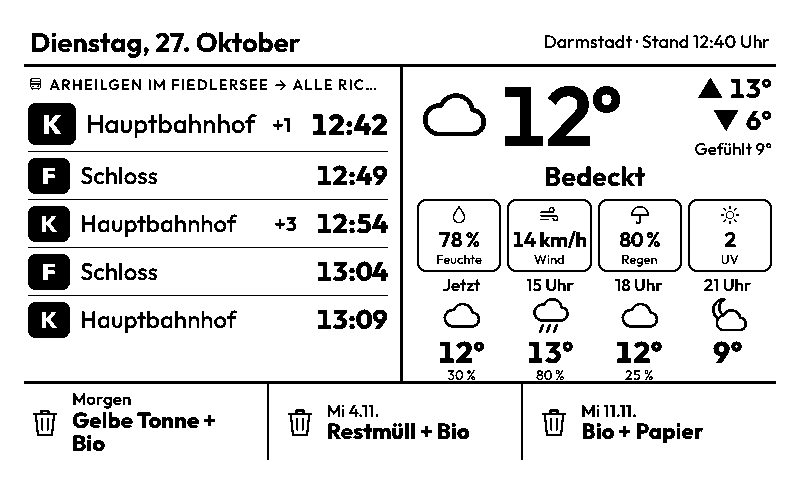
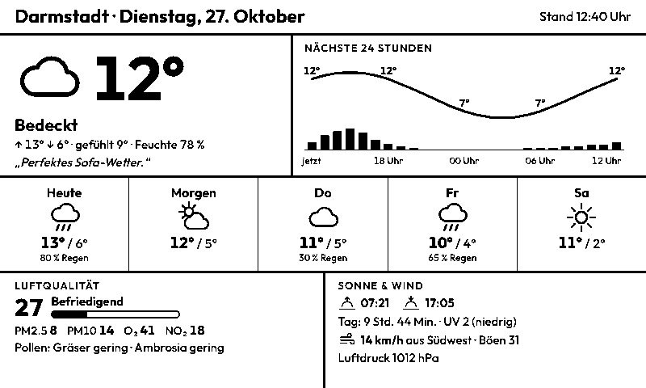
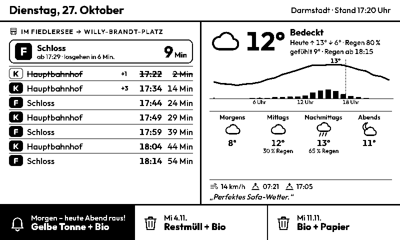
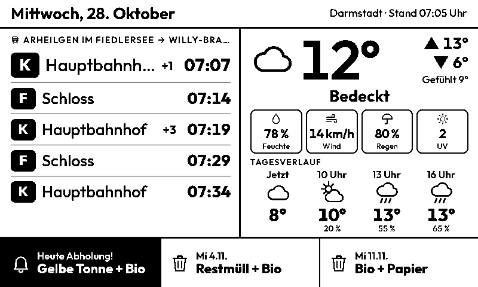
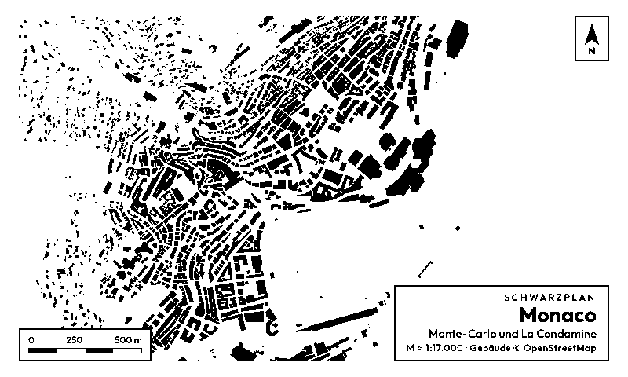
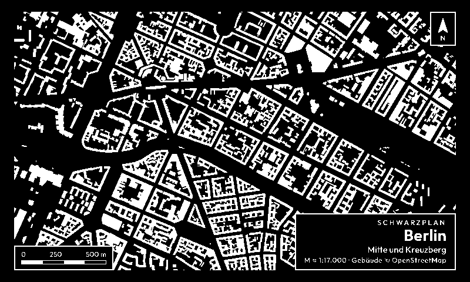
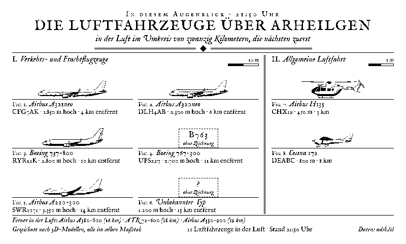

# CYD-Wetter für TRMNL (LaraPaper)

Zwei Seiten für ein TRMNL bzw. das Seeed Studio TRMNL 7,5" (800 × 480, Schwarz-Weiß), gedacht für den eigenen Server [LaraPaper](https://github.com/usetrmnl/larapaper):

| Seite 1: Abfahrt, Wetter & Müll | Seite 2: Wetter ausführlich |
|---|---|
|  |  |

**Seite 1** (alle 5 Minuten neu)
- **links:** die nächsten Abfahrtszeiten an deiner Haltestelle in eine Richtung, die nächste etwas größer. Verspätungen stehen als „+3“ dabei, ausgefallene Fahrten sind durchgestrichen und mit „fällt aus“ markiert. Es gibt bewusst keine Minuten-Countdowns, weil das Display nur alle paar Minuten neu zeichnet.
- **rechts:** das Wetter des Tages wie auf der CYD. Jetzt-Temperatur mit Symbol, Höchst-, Tiefst- und gefühlter Wert, Wetterlage und Spruch, dazu Kacheln für Feuchte, Wind, Regenwahrscheinlichkeit und UV. Darunter der Tagesverlauf: jetzt und dann alle 3 Stunden mit Symbol, Temperatur und Regenwahrscheinlichkeit.
- **unten:** die nächsten 3 Mülltermine. Ab der eingestellten Uhrzeit am Vorabend (Standard 17:00) wird der Termin für morgen schwarz hervorgehoben: „heute Abend raus!“. Am Abholtag bleibt der Hinweis bis 10 Uhr stehen.

| Erinnerung am Vorabend | Am Abholtag morgens |
|---|---|
|  |  |

**Seite 2** (alle 30 Minuten neu): ausführliches Wetter wie auf der CYD-Wetterstation. Enthält die nächsten 24 Stunden, 5 Tage, Luftqualität mit Pollen sowie Sonne und Wind.

Beide Seiten gibt es auch in den kleineren Größen für Mashups (halb waagrecht, halb senkrecht, Viertel), siehe [docs/](docs/).

*Die Bilder sind mit Beispieldaten erzeugt. Linien und Zeiten sind ausgedacht.*

## Einrichten in LaraPaper

1. **ZIP-Dateien holen:** unter [Releases](../../releases) im Release „TRMNL-Plugins“ die Dateien `trmnl-abfahrt.zip` und `trmnl-wetter.zip` herunterladen. Für Testversionen aus einem Branch gibt es eigene Vorab-Releases „TRMNL-Plugins (Branch)“. Alternativ selbst bauen mit `trmnl/build.sh`.
2. **Importieren:** in LaraPaper **Plugins → Import Recipe Archive**, ZIP auswählen, **Import**. Das für beide Dateien wiederholen.
3. **Einstellen:** beim Plugin auf **Configure** klicken. Die Felder sind schon für Darmstadt-Arheilgen, Haltestelle „Im Fiedlersee“ (3024329) und Richtung Willy-Brandt-Platz vorbelegt (siehe unten).
4. **Playlist:** beide Plugins der Playlist deines Geräts hinzufügen. Soll Seite 1 meistens zu sehen sein, Seite 2 seltener oder nur zu bestimmten Zeiten einplanen.
5. **Aktualisierung am Gerät:** Damit die Abfahrten stimmen, muss das Gerät selbst alle 5 Minuten aufwachen. Das stellst du in LaraPaper beim **Gerät** über das Aktualisierungsintervall (Refresh Rate) auf 300 Sekunden ein. Der Akku hält dann deutlich kürzer.

**Updates:** neue ZIP herunterladen und genauso importieren. Die Plugins haben eine feste Kennung (`cyd-abfahrt`, `cyd-wetter`). LaraPaper ersetzt deshalb das vorhandene Plugin und behält deine Einstellungen.

## Einstellungen

| Feld | Bedeutung |
|---|---|
| RMV-API-Schlüssel (optional) | Mit Schlüssel kommen die Abfahrten direkt von der offiziellen RMV-Schnittstelle. Dann muss bei Haltestelle die **Haltestellen-Nummer** stehen. Ohne Schlüssel läuft es über dbf.finalrewind.org. Das Feld ist ein Passwortfeld, der Schlüssel bleibt in LaraPaper. |
| Haltestelle | Mit Schlüssel: Nummer („extId“), nachzusehen im Browser unter `https://www.rmv.de/hapi/location.name?accessId=DEIN_SCHLÜSSEL&input=Fiedlersee&format=json`. Die Nummer (Spalte `HAFAS_ID` der RMV-Haltestellenliste) geht mit und ohne Schlüssel. Standard: `3024329` = Darmstadt-Arheilgen Im Fiedlersee. Ohne Schlüssel geht auch der Name genau in RMV-Schreibweise. Prüfen: [dbf.finalrewind.org/?hafas=RMV](https://dbf.finalrewind.org/?hafas=RMV) |
| Richtung (über) | Nur Fahrten, die danach über diese Haltestelle fahren. **Mit RMV-Schlüssel:** Haltestellen-Nummer, Standard `3024747` = Darmstadt Willy-Brandt-Platz. **Ohne Schlüssel:** Teil des Namens, z. B. `Willy-Brandt-Platz`. Eine Nummer ohne Schlüssel zeigt alle Richtungen. Leer = alle. |
| Verkehrsverbund | Nur ohne Schlüssel: RMV für Darmstadt. Weitere zur Auswahl. |
| Ortsname, Breiten- und Längengrad | Für das Wetter. Nachschlagen auf [open-meteo.com](https://open-meteo.com/en/docs) (oben Ort suchen) oder [latlong.net](https://www.latlong.net/) (auf die Karte klicken). Dezimalgrad mit Punkt, z. B. `49.87`. |
| Straße für den Müllkalender | Straßenname wie im [EAD-Abfallkalender](https://www.ead.darmstadt.de/unser-angebot/privathaushalte/abfallkalender), **ohne Hausnummer**. Bei Straßen, die der EAD aufteilt, den Abschnitt mitschreiben, z. B. `Heinheimer Straße 1-15, 2-16`. Leer = keine Müll-Leiste. |
| Schriftgröße | **Groß** (Standard): 5 Abfahrten, große Temperaturen und Schrift, aus der Ferne lesbar. **Normal**: bis zu 9 Abfahrten, 6 Zeitpunkte im Tagesverlauf und Wetterspruch, die frühere Ansicht ([Bild](docs/seite1-normal.png)). |
| Rand (für Bilderrahmen) | Abstand des Inhalts zum Displayrand: ohne, schmal, mittel (Standard), breit. In Mashups halber Rand. Gibt es auf beiden Seiten. |
| Müll-Erinnerung ab | Uhrzeit am Vorabend, ab der der Termin hervorgehoben wird (15–20 Uhr). |
| Wetterspruch | Ein Spruch pro Tag wie auf der CYD. Auf Seite 1 und 2 abschaltbar. |

## Kunst: Schwarzplan und Tafel der Luftfahrzeuge

Zwei eigenständige Plugins nach den Artefakten „Flur-Rahmen Datenkunst“ (Schwarzpläne) und „Tafel der Luftfahrzeuge“. Beide nutzen den mittleren Rand.

| Schwarzplan | invertiert | Tafel der Luftfahrzeuge |
|---|---|---|
|  |  |  |

### Schwarzplan (`trmnl-schwarzplan.zip`)

- **Jeden Tag im Jahr ein anderer Ort**, 365 Schwarzpläne aus aller Welt. Am 1. Januar kommt Arheilgen. Danach wechselt die Weltgegend Tag für Tag, und dieselbe Stadt kommt frühestens nach gut drei Monaten wieder (andere Viertel derselben Stadt).
- Nur die Gebäude aus OpenStreetMap, alle Orte im selben Maßstab (2,6 km Bildbreite, am 7,5-Zoll-Display etwa 1:17.000), dazu Nordpfeil, Maßstabsbalken und Ortsname.
- Einstellungen: **Darstellung** (Schwarz auf Weiß oder invertiert), **Beschriftung** (mit Ortsname oder nur der Plan), Rand, Uhrzeit für den Tageswechsel.
- Die Orte stehen mit Tag, Name, Viertel und Koordinaten in [`kunst/schwarzplan/orte.json`](kunst/schwarzplan/orte.json). Darunter sind Deutschland (40), Westeuropa (60), Südeuropa (55), Nord- und Osteuropa (50), Nahost und Afrika (45), Asien (60), Amerika (45) und Ozeanien (10).
- Die GitHub Action „Schwarzpläne erzeugen“ zeichnet die Pläne aus OpenStreetMap. Weil der Dienst langsam ist, arbeitet sie in Runden von etwa 50 Minuten und startet sich selbst neu, bis alle fertig sind. Fertige Pläne bleiben im Release liegen. Solange ein Tag noch keinen Plan hat, zeigt das Plugin der Reihe nach einen der vorhandenen. Ändert man `orte.json`, werden nur die neuen Orte gezeichnet.

### Tafel der Luftfahrzeuge (`trmnl-flugzeuge.zip`)

- Alle Luftfahrzeuge, die **gerade jetzt** im Umkreis von Arheilgen in der Luft sind, die nächsten zuerst. Gezeigt werden sie als gestochene Seitenansichten aus der Tafel, alle im selben Maßstab: links bis zu 6 Verkehrsflugzeuge, rechts bis zu 3 kleine Flugzeuge oder Hubschrauber, jeweils mit Flugnummer, Höhe und Entfernung. Wer nicht mehr auf die Tafel passt, steht unter „Ferner in der Luft“.
- **Typen ohne Zeichnung** (zum Beispiel ATR 72 oder Boeing 767) bekommen ein gestricheltes Typenschild mit ihrem ICAO-Kürzel. Für 17 Grundtypen gibt es Zeichnungen, verwandte Typen nutzen die Zeichnung ihrer Familie (A319 und A320 die des A320neo, alle 737 die der 737-800 und so weiter). Die Zuordnung steht in [`kunst/flugzeuge/typen.py`](kunst/flugzeuge/typen.py).
- Daten: LaraPaper fragt alle 5 Minuten [adsb.lol](https://adsb.lol) ab, kostenlos und ohne Schlüssel. Es läuft kein Skript bei dir.
- Einstellungen: Ort und Koordinaten, Umkreis (10 bis 30 km), **Zeichnung** (Stich mit Schraffur oder nur Linien), Rand.

## Datenquellen (alle ohne API-Schlüssel)

| Was | Quelle |
|---|---|
| Wetter, Luftqualität, Pollen | [Open-Meteo](https://open-meteo.com) |
| Abfahrten | mit Schlüssel: [RMV Open Data](https://opendata.rmv.de) (`departureBoard`). Ohne: [dbf.finalrewind.org](https://dbf.finalrewind.org) (DB-Infoscreen) mit der RMV-Fahrplanauskunft (HAFAS) |
| Müll | EAD Darmstadt, Abfallkalender nach Straße (dieselbe Schnittstelle nutzt [Waste Collection Schedule](https://github.com/mampfes/hacs_waste_collection_schedule)) |

Müllarten: `RM1/RM2/RM4` = Restmüll, `WET` = Gelbe Tonne, `BIO` = Bio, `PPK` = Papier. Unbekannte Kürzel erscheinen unverändert.

## Wenn etwas nicht passt

| Anzeige | Lösung |
|---|---|
| „Haltestelle beim RMV nicht gefunden“ (früher `svcRestL(0).err is LOCATION`) | Der Name stimmt nicht exakt. RMV-Schlüssel eintragen und die Haltestellen-Nummer verwenden, oder den Namen genau in RMV-Schreibweise eintragen. |
| „RMV antwortet nicht“ | API-Schlüssel prüfen, und bei Haltestelle muss die Nummer stehen, nicht der Name. |
| Keine Fahrten mit Richtung | Schreibweise der Richtungs-Haltestelle prüfen oder das Feld testweise leeren |
| „Straße im EAD-Kalender nicht gefunden“ | Straßenname wie im EAD-Abfallkalender schreiben, ggf. mit Abschnitt |
| Uhrzeit falsch | Die Uhrzeit kommt aus der Zeitzone der Wetterdaten. Breiten- und Längengrad prüfen. |

## Für Entwickler

```
trmnl/
  common/basis.liquid     Schrift, Stil, Symbole, Uhrzeit/Datum, Bausteine cw_icon und cw_text
  common/spruch.liquid    Wetterspruch
  plugins/abfahrt/        Seite 1: settings.yml, logik.liquid, full/half_*/quadrant.liquid
  plugins/wetter/         Seite 2: settings.yml, logik.liquid, full.liquid, kompakt.liquid (für alle kleinen Größen)
  build.sh                baut dist/trmnl-*.zip (shared.liquid = basis + logik + spruch)
  vorschau/vorschau.sh    rendert eine Seite mit Beispieldaten als PNG (gleiche Liquid-Engine wie LaraPaper)
```

- Uhrzeit und Datum werden ohne Datumsfilter berechnet: aus `trmnl.system.timestamp_utc` und dem UTC-Versatz von Open-Meteo. Das funktioniert unabhängig von der Zeitzone des LaraPaper-Servers.
- Alles ist nur Schwarz/Weiß ohne Graustufen gestaltet und mit eigenem Stil, unabhängig vom TRMNL-Framework.
- Eigenheiten der Liquid-Engine in LaraPaper: `slice` mit negativem Start liefert bei kurzen Texten nichts, und `"" | split` ergibt einen Eintrag. Deshalb wird beides hier vermieden.
